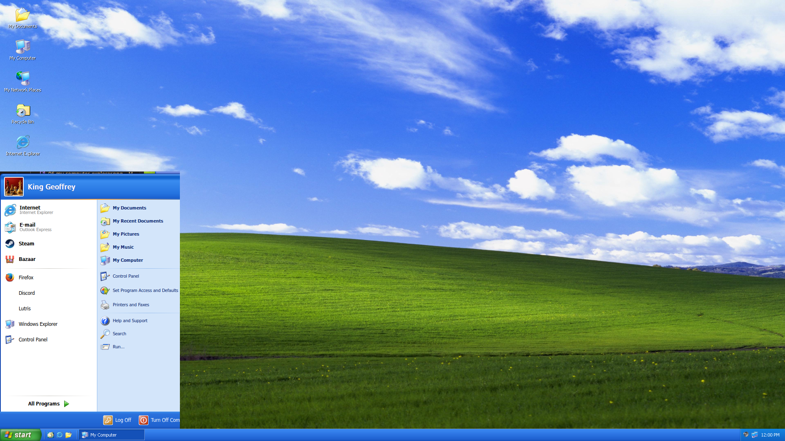
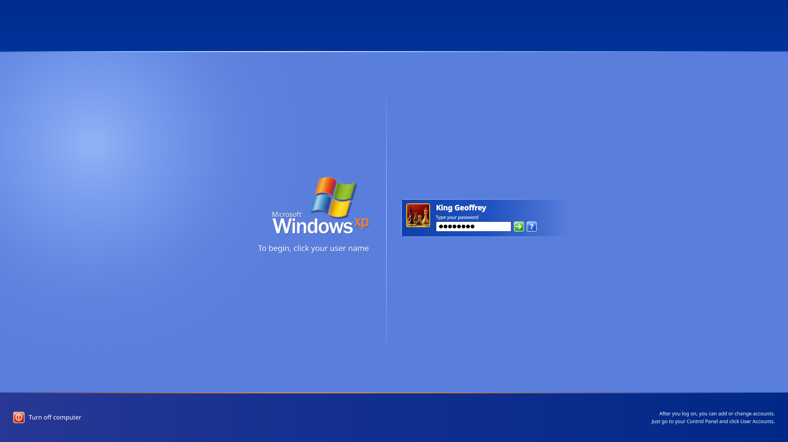
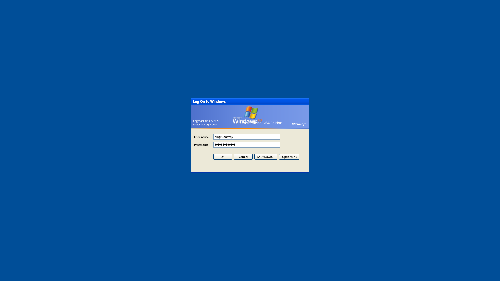
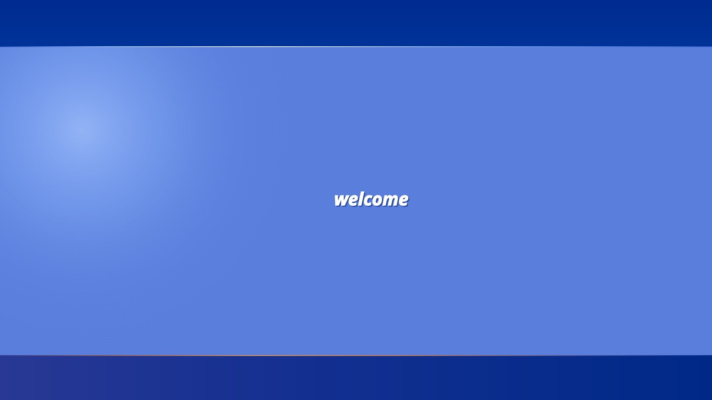
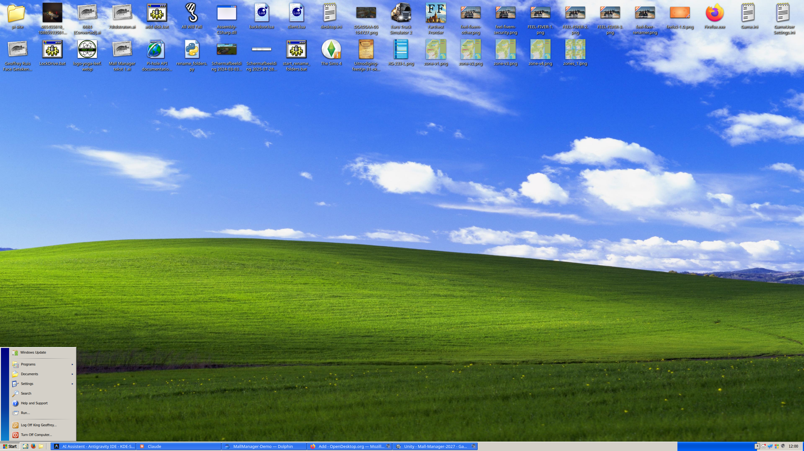
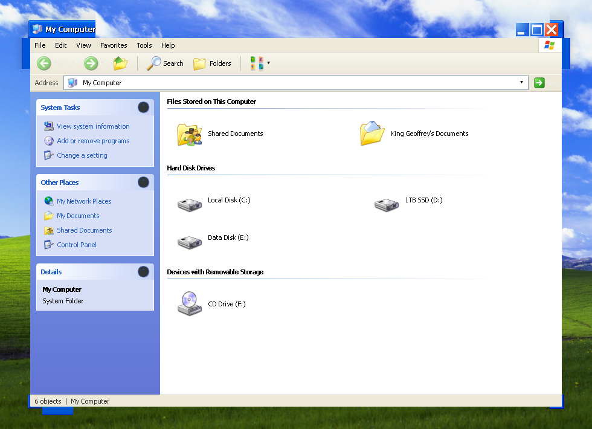
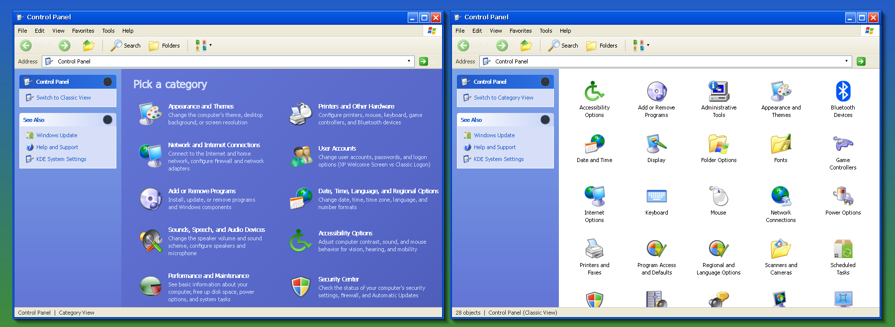
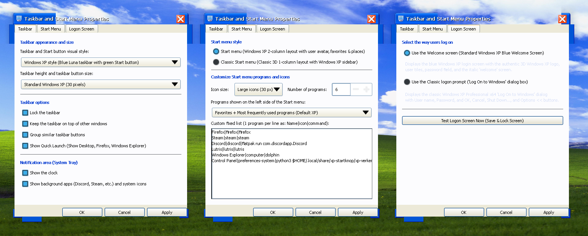
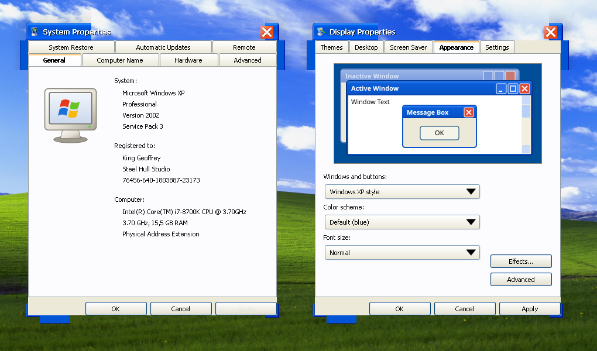
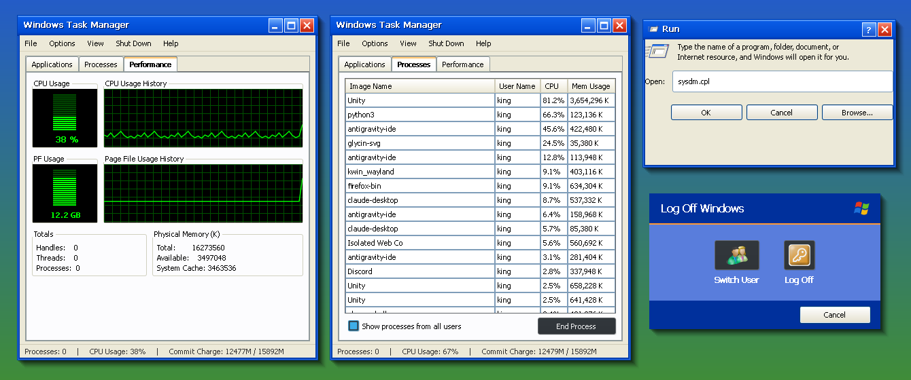

# 🪟 Bazzite KDE — Windows XP Professional (Luna Blue & Classic) Complete Suite

Transform your **Bazzite KDE Plasma 6** desktop into an authentic, pixel-perfect **Windows XP Professional (Service Pack 3)** experience with a single command — including full support for switching between **Windows XP Luna Blue** and **Windows Classic 3D**!

[](LICENSE)
[](https://bazzite.gg)
[](#features)

---

## 📸 High-Resolution Screenshot Gallery

### 1. Windows XP Luna Desktop & Start Menu
The authentic Windows XP experience: rolling green hills of the **Bliss** wallpaper, 3D glossy green **start** button, Quick Launch bar (*Show Desktop*, *Firefox*, *Windows Explorer*), 2-column Start Menu with avatar, and the light-blue notification area with running background apps (*Discord*, *Steam*, etc.).


---

### 2. Windows XP Welcome Screen (Logon / Lock Screen)
Authentic 3D Microsoft Windows XP logo, subtle light orb gradient, user accounts with avatars, password box with animated hint balloons, power button (*Turn off computer*), and account management footer.


---

### 3. Classic "Log On to Windows" Screen
The iconic enterprise Windows XP Professional x64 Edition logon dialog box on `#004e98` background, complete with *User name*, *Password*, *OK*, *Cancel*, *Shut Down...*, and *Options <<* buttons.


---

### 4. Windows XP "welcome" Splash Screen
The classic italic glowing *welcome* splash screen displayed while logging into the desktop session.


---

### 5. Windows Classic Start Menu & 3D Taskbar
Prefer the classic workstation aesthetic? Switch to the classic gray 3D `[ 🪟 Start ]` button, classic 1-column Start menu with the vertical *Windows XP Professional* blue gradient banner, and recessed classic system tray.


---

### 6. My Computer (Windows Explorer)
Authentic Windows XP Explorer interface with collapsible blue task panes (*System Tasks*, *Other Places*, *Details*), drives categorized by *Files Stored on This Computer*, *Hard Disk Drives* (C:, D:, E:), and *Devices with Removable Storage* (CD Drive F:).


---

### 7. Control Panel (Category View & Classic View)
Full navigation supporting both Windows XP's intuitive **Category View** (*Pick a category*) and the traditional **Classic View** displaying all 28 Control Panel applets with authentic XP icons.


---

### 8. Taskbar, Start Menu & Logon Screen Properties
Full configuration suite accessible via **Right-click on Start button -> Properties**:
- **Taskbar tab**: Switch between Luna and Classic, adjust taskbar height & button size (30, 36, 42, 48 px), toggle Quick Launch & Clock.
- **Start Menu tab**: Switch between Luna 2-column and Classic 1-column, adjust icon size (Large 30px / Small 20px), item count, and item source (Favorites / Most used / Custom fixed list).
- **Logon Screen tab**: Choose between the Welcome Screen and Classic Logon dialog, with instant test lock button.


---

### 9. System Properties & Display Properties
Authentic replicas of `sysdm.cpl` and `desk.cpl` with live hardware details (CPU, RAM, OS info) and interactive window appearance previews.


---

### 10. Windows Task Manager, Run Dialog & Turn Off Computer
- **Windows Task Manager**: Live Applications list, searchable Processes list, and green-on-black CPU Usage & Page File Usage graphs.
- **Run Dialog**: `sysdm.cpl`, `control`, `explorer`, `cmd`, or any Linux terminal command.
- **Authentic Turn Off Computer**: Pixel-perfect Windows XP Stand By, Turn Off, and Restart dialog matching original XP aesthetics.


---

### 11. 💬 MSN Messenger 2003/2004 & Windows Live Suite
A complete, authentic recreation of the legendary **MSN Messenger 6.0/7.0 & Windows Live Messenger** experience:
- **Startup & Login Screen**: 3D buddy avatar, email dropdown (`KingGeoffrey@hotmail.com`), password box, status selector (*Online*, *Busy*, *Be Right Back*, *Away*, *On The Phone*, *Out To Lunch*, *Appear Offline*), *Remember Me*, *Remember Password*, and 3D Luna *Sign In* button.
- **Buddy List Window**: Profile card with display name, customizable personal message (*listening 2 music ♫*), subtoolbar (*Webcam*, *Hotmail ✉*, *Call*, *Search*), searchable contact filter, and collapsible groups (*Online*, *Away*, *Busy*, *Offline*).
- **Conversation / Chat Window**:
  - Action toolbar: *Invite*, *Send Files*, *Video*, *Voice*, *Activities*, *Games*, *Block*.
  - Chat history with timestamps, nick colors, buddy avatars, and emoticon support.
  - **The Legendary Nudge**: Click the *⚡ Nudge!* button to play the classic `nudge.wav` sound and watch the chat window shake across the screen! Contacts reply and nudge back!
  - Emoticon picker popup with classic retro smileys.
- **MSN Toast Popup**: Authentic toast notification sliding up from the system tray when contacts sign in, accompanied by the nostalgic `online.wav` chime.
- **Desktop & Start Menu Integration**: Launch via Start Menu -> *MSN Messenger* or `msn.desktop`.

---

### 12. 🎮 Discord & Vesktop Integration (with Retro MSN Theme)
- **Discord via Vesktop**: Clicking **Discord** in the Start Menu launches **Vesktop** (`flatpak run dev.vencord.Vesktop`).
- **Discord Legacy**: Official Discord remains accessible under **Discord Legacy** (`flatpak run com.discordapp.Discord`).
- **Windows XP MSN Messenger Theme for Vesktop**:
  - A custom Vencord theme (`vesktop-theme/Windows-XP-MSN-Messenger.theme.css`) that transforms Discord into MSN Messenger 2004!
  - Features Luna Blue headers, Tahoma typography, classic retro chat formatting (`User says:`), and XP status indicators.
  - Installed automatically to `~/.var/app/dev.vencord.Vesktop/config/vesktop/themes/`. Toggle anytime in Vesktop Settings -> Themes.

---

### 13. 🌐 Internet Explorer 6 Theme for Firefox
- **Authentic IE6 Interface**: Classic XP toolbar buttons (*Back*, *Forward*, *Stop*, *Refresh*, *Home*, *Favorites*), 3D embossed address bar combobox, globe icon, and classic status bar.
- **Modern Firefox Compatibility**: Works with modern Firefox on Linux (both Flatpak and native).
- **Auto-Configured**: Fully integrated in `installeren.sh` (or install standalone with `bash installeren.sh firefox`). See [FIREFOX-IE6.md](FIREFOX-IE6.md) for full guide and customization.

---

## ⚡ 1-Command Installation

Open a terminal on your Bazzite KDE machine and run:

```bash
git clone https://github.com/RuisSoftware/Bazzite-Windows-XP.git
cd Bazzite-Windows-XP
bash installeren.sh
```

The script will automatically configure your wallpapers, sounds, cursor theme, icons, fonts, plasmoids, lock screen, and system tray.

---

## 🤖 Install via AI Agent (Claude Code, Antigravity, Cursor, etc.)

Give this prompt to your AI coding agent running on Bazzite:

> ```text
> Please configure my Bazzite KDE Plasma 6 desktop as an authentic Windows XP Professional (Luna Blue & Classic) environment using this repository: https://github.com/RuisSoftware/Bazzite-Windows-XP (or Bazzite-Windows-XP-Compleet.zip).
> 
> Execute these steps autonomously:
> 1. Clone https://github.com/RuisSoftware/Bazzite-Windows-XP (or extract the zip).
> 2. Verify dependencies (zstd, tar, python3-gobject - standard on Bazzite).
> 3. Run: bash installeren.sh
> 4. Ensure the bottom panel has the XP Start & Quick Launch plasmoid (nl.steelhull.xpstart) on the left and the XP System Tray (nl.steelhull.xptray) on the right. If needed, update ~/.config/plasma-org.kde.plasma.desktop-appletsrc and run systemctl --user restart plasma-plasmashell.service.
> 5. Confirm python3 ~/.local/share/xp-startknop/xp-verkenner.py sni-list executes properly and notify me when complete!
> ```

---

## 📦 KDE Store / Pling Packages (`kde-store-pakketten/`)

Ready-to-upload packages formatted according to official KDE Store / Opendesktop guidelines:

| Package File | Store Category | Description |
|---|---|---|
| `nl.steelhull.xpstart.plasmoid` | Plasma 6 Applets | Windows XP Luna & Classic Start Menu + Quick Launch |
| `nl.steelhull.xptray.plasmoid` | Plasma 6 Applets | Windows XP Luna & Classic System Tray with background apps |
| `org.magpie.xpluna.desktop.tar.gz` | Plasma Global Themes | Windows XP Luna Global Theme & SDDM / Lockscreen |

See [`KDE-STORE-PUBLISHING.md`](./KDE-STORE-PUBLISHING.md) for step-by-step upload instructions.

---

## 📄 License
This project is open-source under the [GNU General Public License v3.0](LICENSE).
Windows XP visual design and trademarks are property of Microsoft Corporation.
